# When to Share Channels: A Three-Axes Framework for Learning Strategy Benchmarking in MTSF

Hyunwoong Lim (Korea University), Junhyeok Kang (LG AI Research), Susik Yoon (Korea University)

Code: https://github.com/Burugi/TS-CDCI

## Abstract

Multivariate time series forecasting (MTSF) is a fundamental task that requires modeling both temporal dependencies and inter-channel relationships. Deep learning-based models have been widely adopted under two dominant learning strategies: **Channel-Dependent (CD)** approaches, which jointly leverage information from multiple channels, and **Channel-Independent (CI)** approaches, which process each channel separately. Despite their widespread use, limited understanding exists regarding when each strategy is most effective.

To address this gap, we propose a **three-dimensional analysis framework** comprising **Architecture**, **Scope**, and **Level**, which extends beyond conventional backbone-based categorization to enable fine-grained model characterization into **48 distinct types**. We conduct a comprehensive empirical study across **20 models** and **10 real-world datasets**, demonstrating that **no universal winner exists** among models or strategies; optimal choices are dataset-dependent.

Our framework reveals that the performance gaps between CD and CI vary systematically with model design, highlighting the necessity for automatic model selection. We validate this idea through **BrickTS**, a prototype modular forecasting model implemented under our three-dimensional framework. BrickTS not only confirms that performance variations align with the proposed dimensions but also identifies unexplored configurations that outperform existing baselines, demonstrating a promising direction to guide automatic agentic systems for MTSF.

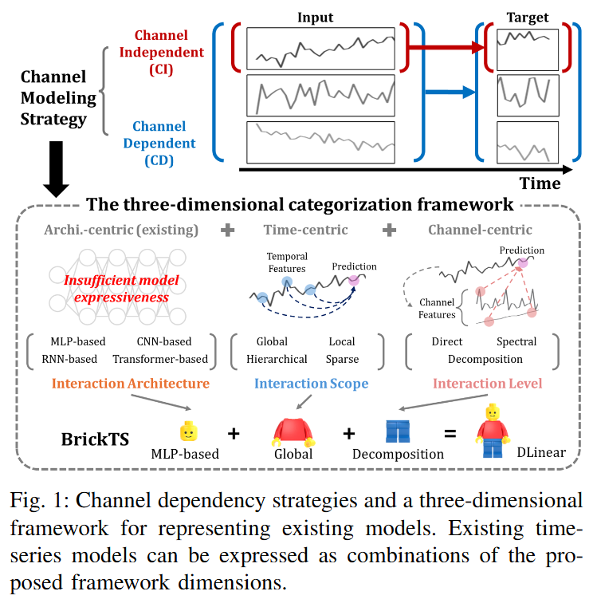

## Problem and Approach

Most prior work argues that a particular strategy or model is broadly applicable, but those claims usually come from a narrow set of datasets or a single model family. The deeper issue is that the conventional backbone taxonomy (MLP, RNN, CNN, Transformer) is too coarse to explain why the CD/CI gap shifts from one model to another. As a result, picking a strategy for a new dataset is either tied to a specific model or requires training every configuration under both strategies, which is expensive and does not transfer.

We address this with three orthogonal axes that describe how a model handles channels and time:

- **Interaction Architecture** captures the backbone (MLP, RNN, CNN, Transformer).
- **Interaction Scope** captures how temporal dependencies are reached (Global, Local, Hierarchical, Sparse).
- **Interaction Level** captures how channel features are extracted (Direct, Decomposition, Spectral).

Together the axes yield 48 distinct model types. We benchmark 20 models in both CD and CI form (40 variants) and then isolate each axis with **BrickTS**, a modular model whose components map one-to-one to the three axes, so performance differences can be attributed to the axes rather than to model-specific tricks. Finally, a lightweight selector turns the framework into a practical recommendation tool. The study is organized around four research questions:

1. **RQ1.** Is there a universally effective strategy or model across datasets?
2. **RQ2.** How do the three axes shape the CD/CI gap?
3. **RQ3.** Can systematic exploration of axis combinations find competitive configurations?
4. **RQ4.** Can the framework guide CD/CI selection for unseen datasets?

## Three-Axes Framework

| Axis | Categories | What it describes |
|------|------------|-------------------|
| Interaction Architecture | MLP, RNN, CNN, Transformer | Backbone network type |
| Interaction Scope | Global, Local, Hierarchical, Sparse | Range of temporal dependency |
| Interaction Level | Direct, Decomposition, Spectral | How channel features are extracted |

| Architecture | Scope | Level |
|:---:|:---:|:---:|
| 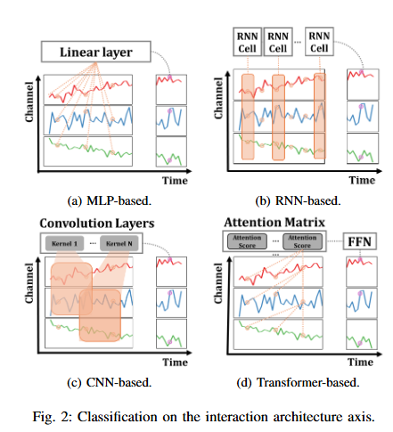 | 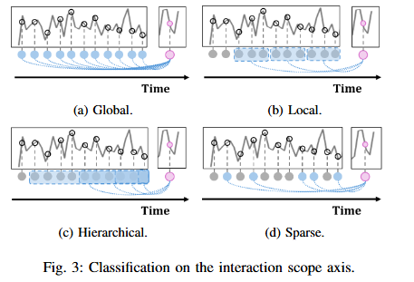 | 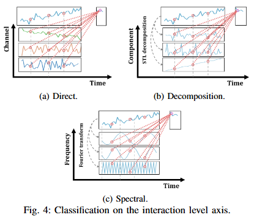 |

The 20 benchmarked models map onto the three axes as follows (Table I in the paper).

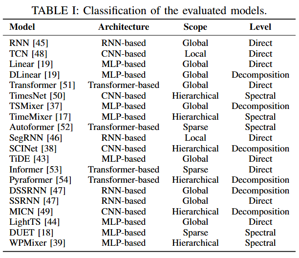

## Hyperparameter Search Space

We tune each model with Optuna using Bayesian optimization, evaluating 10 candidate configurations per model-dataset pair. The search space is shared for common training hyperparameters and extended per model.

| Model | Parameter | Type | Range / Choices |
|-------|-----------|------|-----------------|
| Common | learning_rate | float (log) | 1e-5 ~ 1e-2 |
| | batch_size | categorical | [32, 64, 128, 256] |
| | dropout | float | 0.1 ~ 0.5 |
| DLinear | moving_avg | categorical | [7, 13, 25] |
| RNN | hidden_size | categorical | [64, 128, 256, 512] |
| | num_layers | int | 1 ~ 3 |
| | rnn_type | categorical | [LSTM, GRU] |
| TCN | num_channels | categorical | [[16,32,64], [32,64,128], [64,128,256]] |
| | kernel_size | int | 3 ~ 7 |
| Transformer | d_model | categorical | [64, 128, 256, 512] |
| | n_heads | categorical | [4, 8] |
| | e_layers | int | 1 ~ 3 |
| | d_ff | categorical | [256, 512, 1024] |
| | activation | categorical | [relu, gelu] |
| TimeMixer | d_model | categorical | [64, 128, 256, 512] |
| | d_ff | categorical | [128, 256, 512, 1024] |
| | e_layers | int | 1 ~ 3 |
| | down_sampling_layers | int | 1 ~ 3 |
| | down_sampling_method | categorical | [avg, max, conv] |
| BrickTS | level_type | categorical | [direct, decomposition, spectral] |
| | scope_type | categorical | [global, local, hierarchical, sparse] |
| | arch_type | categorical | [mlp, rnn, cnn, transformer] |

## Results

CI wins accuracy in 60% of the 200 model-dataset combinations and uses less peak GPU memory in 79.5%, but it is faster only 50% of the time, so no strategy dominates (Table III).

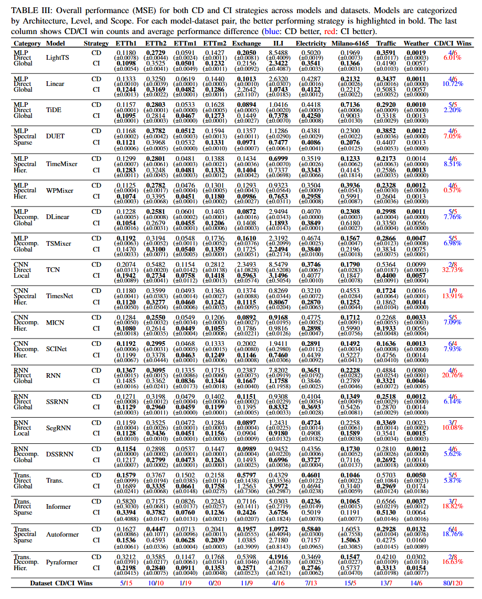

Averaged over all datasets the CD/CI difference is not statistically significant (Fig. 6).

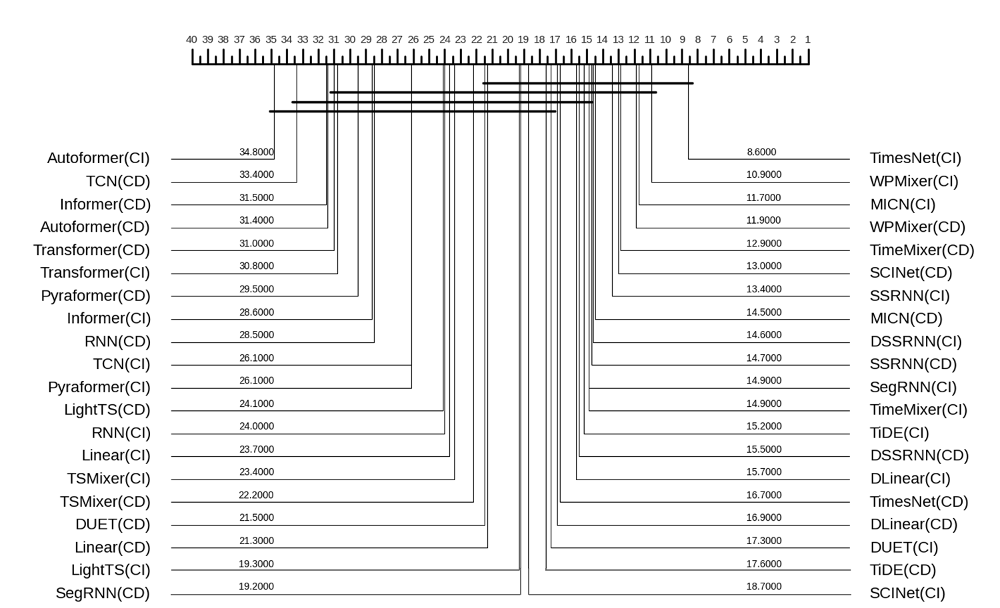

Simple BrickTS configurations stay competitive with sophisticated baselines, beating 39 of 40 pairs on Electricity and 36 of 40 on Traffic, and several winning configurations are designs not explored in prior work (Table V).

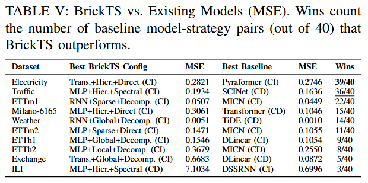

## Running the Experiments

### 1. Environment

```bash
conda create -n cdci python=3.11
conda activate cdci
pip install -r requirements.txt
```

### 2. Prepare datasets

Place the CSV files under `./dataset/`.

### 3. Hyperparameter search

```bash
# CD
python run_hyperopt.py \
    --model DLinear --data ETTh1 --mode CD \
    --root_path ./dataset/ --data_path ETTh1.csv \
    --seq_len 96 --pred_len 96 --n_trials 10

# CI
python run_hyperopt.py \
    --model DLinear --data ETTh1 --mode CI \
    --root_path ./dataset/ --data_path ETTh1.csv \
    --features OT --target_features OT \
    --seq_len 96 --pred_len 96 --n_trials 10
```

### 4. Training

```bash
python run_training.py \
    --model DLinear --data ETTh1 --mode CD \
    --root_path ./dataset/ --data_path ETTh1.csv \
    --seq_len 96 --pred_len 96 --n_repeats 5
```

### 5. BrickTS

```bash
# BrickTS picks one option per axis (level_type, scope_type, arch_type)
python run_hyperopt.py --model BrickTS --mode CD --data ETTh1 \
    --root_path ./dataset/ --data_path ETTh1.csv \
    --seq_len 96 --pred_len 96 --n_trials 10
```

Results are written to `results/{dataset}/{seq_len}_{pred_len}/{model}_{mode}_results.json`, with overall MSE/MAE, per-channel scores, and scalability fields (inference time, peak memory, parameter count).

## BrickTS Additional Experiment: CD/CI Selector on Milano

The benchmark measures the CD/CI gap directly, but that measurement is not available for a brand new dataset. The selector replaces exhaustive both-strategy training with a cheap lookup from dataset features and the framework coordinates.

**Dataset.** The Milano telecommunication dataset records mobile activity across geographic regions of Milan. Each region carries five channels (SMS-in, SMS-out, calls-in, calls-out, internet traffic) aggregated into 10-minute intervals, with internet traffic as the target. The regions share a common daily structure but differ in their channel characteristics, which makes them a good testbed for generalization to unseen data.

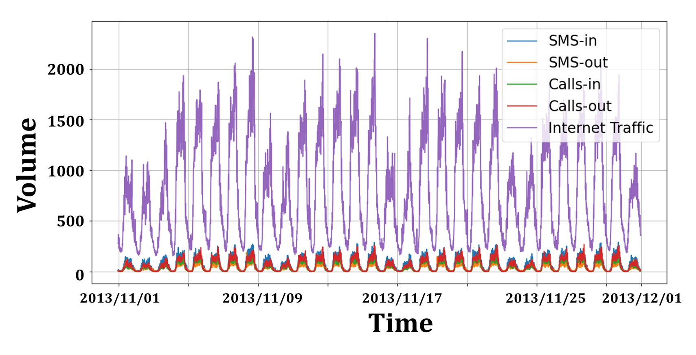

**Inputs.** For every BrickTS configuration on a region, the selector input concatenates 57 dataset features and 11 one-hot framework coordinates (4 Architecture + 4 Scope + 3 Level). The 57 features summarize the target channel and its relationship to the other channels:

- Complexity and entropy of the target channel: detrended fluctuation analysis, sample / permutation / spectral entropy, Hjorth mobility and complexity.
- Memory and scale: autocorrelation first-zero crossing, number of significant PACF lags, dominant period, multi-scale entropy, series length, channel count.
- Decomposition and frequency: STL trend and seasonal strength, ADF and KPSS statistics, spectral concentration, wavelet entropy.
- 22 catch22 descriptors of the target channel (pycatch22).
- Cross-channel relationship: Pearson correlation with the other channels (mean / max / top-3), catch22 similarity, mutual information, Granger causality ratio, variance ratio.
- Distribution shift: windowed KL divergence shift, transition-matrix trace.

**Model.** The selector is an **XGBoost** regressor that predicts the CD/CI performance gap. The sign of the predicted gap gives the recommended strategy, and we report **AUC** on the binary CD/CI direction over the unseen test regions.

**Findings.** The selector is reliable when the target channel carries structure that the axes describe. Regions with a long autocorrelation range (large ACF first-zero) and strong trend reach an AUC near 0.93, while near-random regions with high sample entropy collapse to a near tie and drop to about 0.45 (Table IV). The structure therefore matters through the axes rather than on its own.

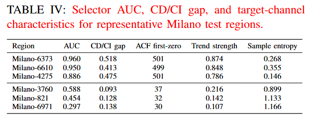

The ablation confirms that the proposed axes add predictive signal beyond a backbone-only view or dataset features alone (Table VI).

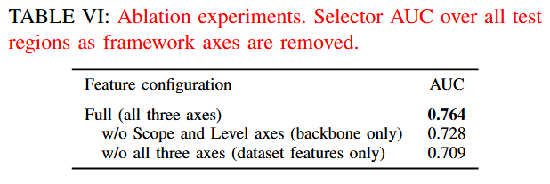
