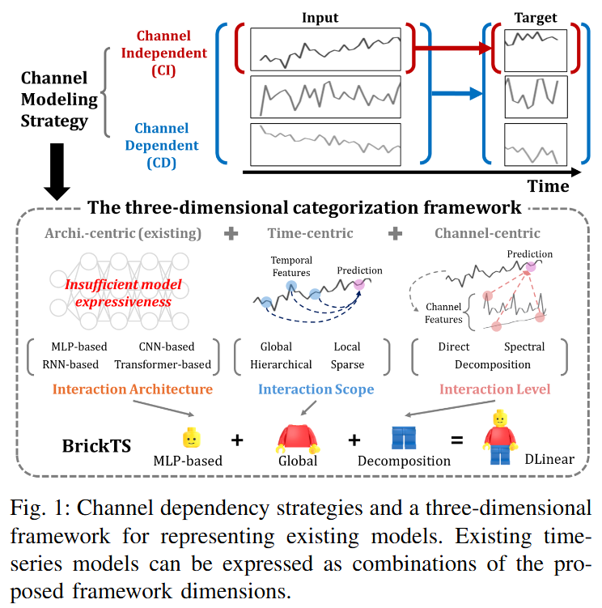
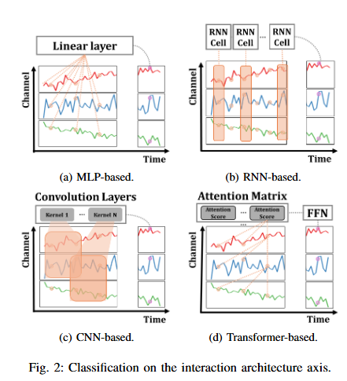
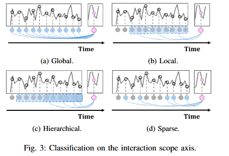
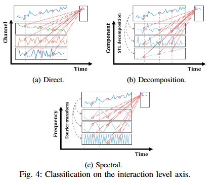
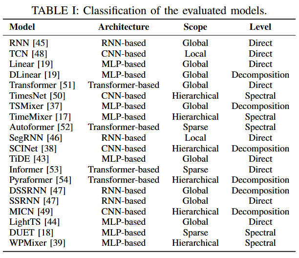

# [VLDB 27 submission 2160]Beyond Backbones: Dissecting Channel Sharing in Multivariate Time Series Forecasting through Architecture, Scope, and Level

Code, configurations, and supplementary material for the paper *Beyond Backbones: Dissecting Channel Sharing in Multivariate Time Series Forecasting through Architecture, Scope, and Level* (submitted to VLDB 2027, Experiment, Analysis & Benchmark track). Material that did not fit in the paper is collected in [`appendix/appendix.pdf`](appendix/appendix.pdf).

## Abstract
Multivariate time series forecasting (MTSF) relies on two dominant learning strategies: **channel-dependent (CD)** approaches, which jointly leverage multiple channels, and **channel-independent (CI)** approaches, which process each channel separately. Despite their widespread use, limited understanding exists regarding when each strategy is most effective. To address this gap, we propose a **three-dimensional analysis framework** comprising **Architecture**, **Scope**, and **Level**, extending conventional backbone-based categorization into **48 fine-grained model types**. Across **20 models** and **10 real-world datasets**, we show that neither a model nor a learning strategy is a universal winner, and that the optimal choice depends jointly on the model and the dataset. Contrary to the common assumption that CI is widely adopted for its efficiency, CI reduces peak memory in most cases but is faster than CD in only half of them. As the CD/CI performance gap varies systematically with model design, the framework guides strategy selection without exhaustive search, which is especially valuable in emerging agentic systems. We validate this through **BrickTS**, a modular forecasting prototype implemented under the framework, which confirms that performance variations align with the proposed dimensions and uncovers unexplored configurations that outperform existing baselines. Building on BrickTS, a lightweight selector predicts the preferred strategy for unseen datasets from dataset features and the framework coordinates, and the observed preferences remain stable across forecasting horizons and normalization, yielding practical guidance for choosing a strategy for a new model or a new dataset before any training.



## Overview

Each model is placed on three axes. The classification of the 20 benchmarked models is Table 2 in the paper, and the formal definition of every category is in Appendix B.

| Axis | Categories | What it describes |
|------|------------|-------------------|
| Interaction Architecture | MLP, RNN, CNN, Transformer | Backbone network type |
| Interaction Scope | Global, Local, Hierarchical, Sparse | Range of temporal dependency |
| Interaction Level | Direct, Decomposition, Spectral | Representation on which channels are compared |

| Architecture | Scope | Level |
|:---:|:---:|:---:|
|  |  |  |



**What we found (details in Section 5 of the paper).**

- No model or strategy wins everywhere. CI is more accurate in 60% of the 200 model-dataset pairs, but the preferred strategy changes with the dataset.
- CI is not uniformly cheaper. It uses less peak GPU memory in 79.5% of the pairs but is faster than CD in only 50%.
- The two new axes explain the CD/CI gap better than the backbone alone. Local-scope models are weak under CD, Hierarchical-scope and Spectral-level models favor CD on datasets with strongly correlated channels, and MLP-based models favor CI.
- BrickTS, which assembles a model from one option per axis, reproduces these tendencies and finds configurations that outperform 39 of 40 baseline model-strategy pairs on Electricity.
- A selector trained on BrickTS results predicts the preferred strategy for unseen Milano regions, and the preferences stay stable across forecasting horizons and under RevIN.

## Quick Start

```bash
conda create -n cdci python=3.11 && conda activate cdci
pip install -r requirements.txt
```

**Datasets.** Put the CSV files under `./dataset/`. Each file has a `date` column and one column per channel, with the target channel named `OT`. Milano-6165 is derived from the public Milano telecommunications dataset (cell 6165, 10-minute aggregation, internet traffic as `OT`, channels `smsin smsout callin callout OT`); the steps are in Appendix D.

**Hyperparameter search.** Set `features` in `configs/hyperopt_config.yaml` to the channel list of the dataset, then run Optuna (10 trials per model and strategy):

```bash
python run_hyperopt.py --data_path ./dataset --file_name ETTh1.csv \
    --models dlinear tcn transformer rnn --modes CD CI --target_feature OT --n_trials 10
```

**Training and evaluation.** Train five times with the best hyperparameters and the paper's budget (30 epochs, patience 10):

```bash
python run_training.py --data_path ./dataset --file_name ETTh1.csv \
    --features HUFL HULL MUFL MULL LUFL LULL OT \
    --models dlinear tcn transformer rnn --modes CD CI --target_feature OT \
    --hyperopt_dir hyperopt_results_075 --training_dir training_results \
    --epochs 30 --patience 10 --n_repeats 5
```

CD models take all channels as input and are evaluated on `OT`. CI models use `OT` only. Results land in `training_results/<model>/<mode>[/<target>]/repeat_<k>/training_results.json`. The input and output lengths are fixed to 96 in `optimization/hyperopt.py` and `training/trainer.py` (36 for Milano-6165 and ILI in the paper).

**Model names.** `linear`, `dlinear`, `tsmixer`, `timemixer`, `tide`, `lightts`, `rnn`, `segrnn`, `ssrnn` (PI-SRNN), `dssrnn` (PIAD-SRNN), `tcn`, `scinet`, `timesnet`, `micn`, `transformer`, `autoformer`, `informer`, `pyraformer`. DUET and WPMixer (`models/DUET.py`, `models/WPMixer.py`) and BrickTS (`models/brickts/`) are provided as model code following the Time-Series-Library interface.

**BrickTS and the selector.** `models/brickts/` builds a model from `level_type`, `scope_type`, and `arch_type` (48 configurations). The notebooks in `brickts_analysis/` extract the 57 dataset features (`01`), train the XGBoost selector on the features plus the 11 one-hot axis coordinates (`02`), evaluate it on unseen Milano regions (`03`), and run the axis ablation (`04`). They read datasets from `../dataset/` and BrickTS results from `../results_BrickTS/`.

## Repository Layout

| Path | Content |
|------|---------|
| `run_hyperopt.py`, `run_training.py` | Entry points for hyperparameter search and repeated training |
| `configs/` | Dataset channel list (`hyperopt_config.yaml`) and per-model search spaces (`hyperopt/*.yaml`) |
| `models/`, `layers/` | Forecasting models and their building blocks, including `models/brickts/` |
| `data/`, `optimization/`, `training/` | Data loading, Optuna objective, and training loop |
| `brickts_analysis/` | Selector notebooks |
| `appendix/appendix.pdf` | Supplementary material (Appendices A to F) |

## Supplementary Material

| Appendix | Content |
|----------|---------|
| A. Implementation Details | Hardware, training configuration, Optuna setup, search spaces, fixed BrickTS hyperparameters |
| B. Formal Definitions of the Three Axes | Full formulations of every Architecture, Scope, and Level category |
| C. Evaluation Results | MAE counterpart of Table 4, MSE for all horizons, inference time and peak GPU memory for all models and datasets, critical difference diagrams per strategy |
| D. Dataset | Description and source of each dataset, Milano-6165 preprocessing |
| E. BrickTS | Pseudocode of every module and the results of all 48 configurations under CD and CI |
| F. RevIN Full Results | MSE of all 48 BrickTS configurations with and without RevIN |

Table, figure, and algorithm numbers in the appendix continue those of the paper.
